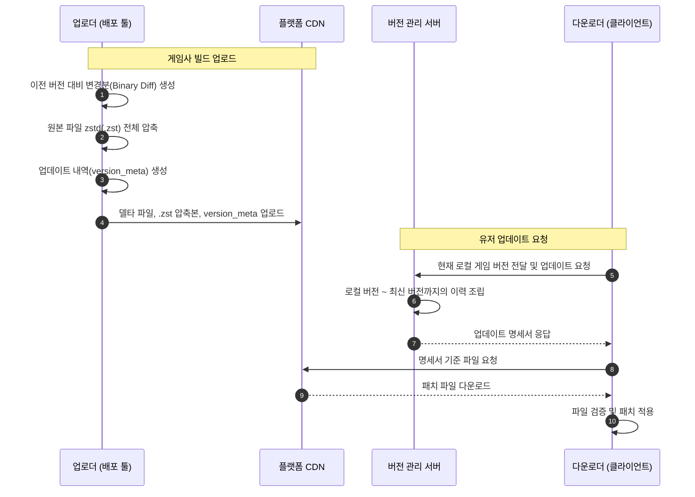
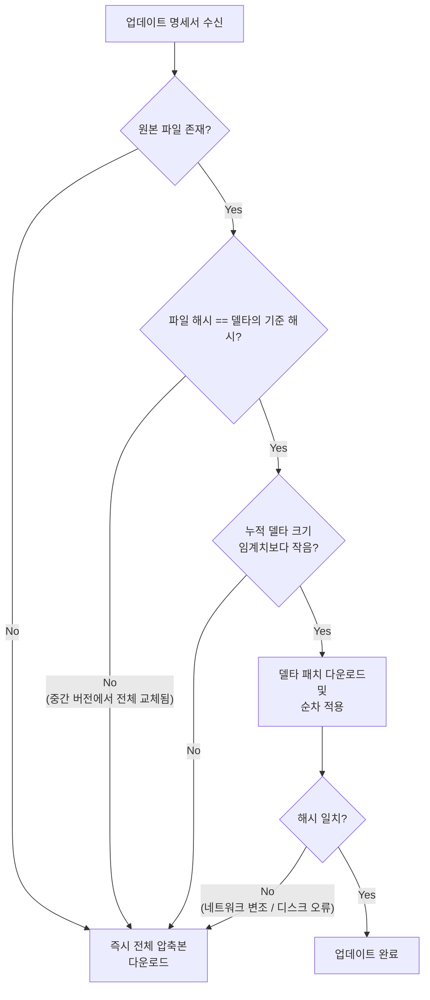
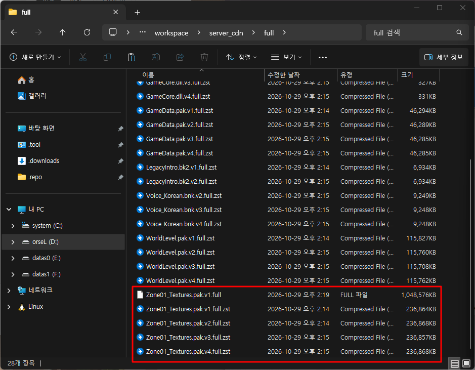
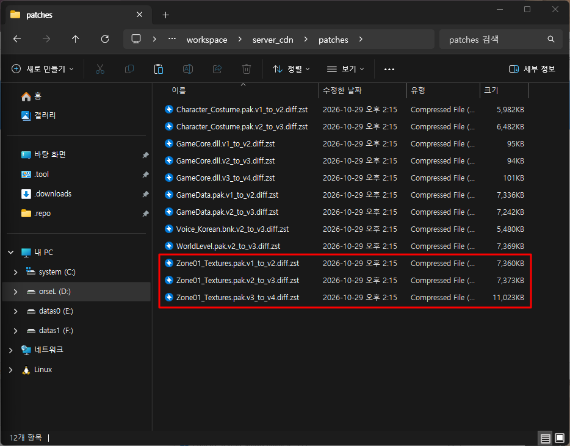
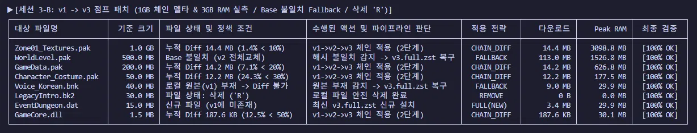

## 델타 패치가 필요했던 이유
대용량 게임을 배포할 때 델타 패치(Delta Patch) 는 게임사와 유저 모두에게 필수적인 기능이다. 게임사는 업데이트 때마다 발생하는 CDN 서빙 트래픽 비용을 줄일 수 있고, 유저는 수정된 일부 파일 때문에 수십 기가에 달하는 전체 파일을 다시 받지 않아도 되니 업데이트 시간이 단축되기 때문이다.
 
 

## 구성별 역할과 패치 프로세스

### 업로더
- 게임사의 빌드 업데이트 내역(`version_meta`)
- 이전 버전 대비 변경분(`binary diff`) 생성 및 원본 파일 압축분 ([Zstandard](https://github.com/meta/zstd) `.zst`) 생성후, 플랫폼 CDN 에 업로드
- 바이너리 차분 생성에는 상용 라이브러리인 [RTpatch](https://www.pocketsoft.com/rtpatch_binary_diff.html) 사용

### 서버 
- 플랫폼 CDN 운영
- 유저가 요청 로컬 게임한 `현재 버전` 부터 `최신 버전` 까지의 히스토리를 조립해, 어떤 파일을 어떻게 패치해야 하는지 적힌 업데이트 명세서(`meta`)를 전달

### 다운로더
- 서버에서 받은 명세서에 따라 CDN 에서 파일을 내려받고 패치를 적용
- 다운로드 ➔ 압축파일 검증 ➔ 압축 해제 및 패치 적용 ➔ 원본 검증
 
 

## 임계치 설정
델타 패치를 적용할지, 아니면 최신 파일을 통째로 내려받을지 결정하는 `임계치(Threshold)` 가 필요했다. 

당시 파트장님은 원본 크기 대비 누적 델타 크기의 비율로 `30~50%` 사이를 후보로 두셨고, 최종적으로는 유저 PC 의 연산 부담과 패치 실패 가능성을 낮추는 방향 을 우선해 보수적인 `30%` 를 택했다.

오랜만에 게임을 실행하는 유저는 본인이 설치해 둔 과거 버전 이후로 쌓인 모든 버전의 델타 패치를 순서대로 전부 적용해야 한다. 거쳐야 할 패치 단계가 많아질수록 압축 해제와 병합에 필요한 시간, CPU, 메모리 사용량이 늘어나고, PC 환경이나 디스크 상태에 따라 중간에 패치가 깨질 위험도 함께 커지기 때문이었다.
 
 

## 패치 분기 시나리오

<table>
    <thead>
        <tr>
            <th style="width: 20%;">파일명</th>
            <th style="width: 20%;">v1 (최초설치)</th> 
            <th style="width: 20%;">v2</th>
            <th style="width: 20%;">v3</th>
            <th style="width: 20%;">v4 (최신)</th>
        </tr>
    </thead>
    <tbody>
        <tr>
            <td>file1</td>
            <td>추가 (100KB)</td>
            <td>델타 (10KB)</td>
            <td>델타 (10KB)</td>
            <td>델타 (5KB)</td>
        </tr>
        <tr>
            <td>file2</td>
            <td>추가 (100KB)</td>
            <td>델타 (20KB)</td>
            <td>델타 (20KB)</td>
            <td>변경 없음</td>
        </tr>
        <tr>
            <td>file3</td>
            <td>추가 (100KB)</td>
            <td>전체 변경 (100KB)</td>
            <td>델타 (10KB)</td>
            <td>전체 변경 (100KB)</td>
        </tr>
        <tr>
            <td>file4</td>
            <td>추가 (100KB)</td>
            <td>변경 없음</td>
            <td>삭제 (<code>R</code>)</td>
            <td>-</td>
        </tr>
        <tr>
            <td>file5</td>
            <td>-</td>
            <td>추가 (100KB)</td>
            <td>델타 (20KB)</td>
            <td>변경 없음</td>
        </tr>
        <tr>
            <td>file6</td>
            <td>-</td>
            <td>추가 (100KB)</td>
            <td>전체 변경 (100KB)</td>
            <td>삭제 (<code>R</code>)</td>
        </tr>
    </tbody>
</table>

### 바로 직전 버전에서 업데이트 (`v1 ➔ v2`)
<table>
    <thead>
        <tr>
            <th style="width: 15%;">파일명</th>
            <th>설명</th>
        </tr>
    </thead>
    <tbody>
        <tr>
            <td>file1, file2</td>
            <td><code>v2</code> 델타 크기가 각각 <code>10KB, 20KB</code> 로 원본(<code>100KB</code>) 의 30% 미만이므로 <code>v2</code> 델타 패치를 내려받아 적용</td>
        </tr>
        <tr>
            <td>file3</td>
            <td>파일 전체가 변경되었으므로 <code>v2.zst</code> 를 내려받아 적용</td>
        </tr>
        <tr>
            <td>file4</td>
            <td>변경 사항이 없으므로 아무 작업도 하지 않음</td>
        </tr>
        <tr>
            <td>file5, file6</td>
            <td><code>v2</code> 에서 새로 추가된 파일이므로 <code>v2.zst</code> 를 내려받아 적용</td>
        </tr>
    </tbody>
</table>

### 한 버전을 건너뛴 업데이트 (`v1 ➔ v3`)
<table>
    <thead>
        <tr>
            <th style="width: 15%;">파일명</th>
            <th>설명</th>
        </tr>
    </thead>
    <tbody>
        <tr>
            <td>file1</td>
            <td><code>v2(10KB) + v3(10KB)</code> 누적 델타 합이 20KB로 원본의 30% 미만이므로, <code>v2 ➔ v3</code> 델타 패치를 차례대로 적용</td>
        </tr>
        <tr>
            <td>file2</td>
            <td><code>v2(20KB) + v3(20KB)</code> 누적 합이 40KB로 30% 이상 이므로, 델타를 포기하고 최신 전체 파일인 <code>v3.zst</code> 를 받아 적용</td>
        </tr>
        <tr>
            <td>file3</td>
            <td><code>v2</code> 에서 파일이 통째로 변경된 적이 있다. 델타를 적용 대신 <code>v3.zst</code> 전체 파일을 받아 적용</td>
        </tr>
        <tr>
            <td>file4</td>
            <td>파일의 작업 유형이 삭제(<code>R</code>)이므로 로컬에서 해당 파일을 제거</td>
        </tr>
        <tr>
            <td>file5</td>
            <td><code>v3</code>가 20KB 델타지만, 로컬(<code>v1</code>)에는 <code>file5</code> 원본 자체가 존재하지 않아 델타를 적용 대신 <code>v3.zst</code> 전체 파일을 받아 적용</td>
        </tr>
        <tr>
            <td>file6</td>
            <td><code>v3</code>에서 전체 변경되었으므로 <code>v3.zst</code>를 받아 적용</td>
        </tr>
    </tbody>
</table>

### 두 버전을 건너뛴 업데이트 (`v1 ➔ v4`)
<table>
    <thead>
        <tr>
            <th style="width: 15%;">파일명</th>
            <th>설명</th>
        </tr>
    </thead>
    <tbody>
        <tr>
            <td>file1</td>
            <td><code>v2 + v3 + v4</code> 델타의 총합이 25KB(25%)로 30% 미만이므로, 세 단계의 델타 패치를 순차적으로 적용</td>
        </tr>
        <tr>
            <td>file2</td>
            <td><code>v2 + v3</code> 합산 시점에서 이미 30% 이상이므로 최신본인 <code>v4.zst</code>를 받아 적용</td>
        </tr>
        <tr>
            <td>file3</td>
            <td><code>v4</code>에서 전체 변경되었으므로 <code>v4.zst</code>로 덮어씁니다.</td>
        </tr>
        <tr>
            <td>file4</td>
            <td>파일의 작업 유형이 삭제(<code>R</code>)이므로 로컬에서 해당 파일을 제거</td>
        </tr>
        <tr>
            <td>file5</td>
            <td>로컬에 원본이 없어 델타 적용에 실패한 뒤, 최신본인 <code>v4.zst</code>를 받아 적용</td>
        </tr>
        <tr>
            <td>file6</td>
            <td>명세서상 <code>v4</code>에서 삭제(<code>R</code>) 처리되었으나, 로컬(<code>v1</code>)에는 처음부터 없던 파일이므로 무시</td>
        </tr>
    </tbody>
</table>
 

## 실패를 전제로 한 Fallback 전략
클라이언트 환경에서는 디스크 용량 부족, 백신 프로그램의 간섭, 임의의 파일 변조 등 언제든 델타 패치가 실패할 수 있다. 따라서, 델타 패치 중 어느 단계에서든 실패하면 즉시 최신 전체 파일 다운로드 하게했다. 델타 적용 실패 후 애매하게 재시도를 반복하며 낭비하기보다, 시간이 조금 더 걸리더라도 한 번에 업데이트를 성공시키는 편이 유저 경험 측면에서 덜 불쾌하고 CS 대응 비용도 줄일 수 있다고 생각했다.
 
 

## Zstandard `--patch-from` 검증
`zstd`를 파일 압축에만 쓰고, 델타 생성 및 병합에는 상용 라이브러리인 `RTpatch`를 조합해 사용했다. 

이 문서를 작성하면서 알게되었는데, `zstd` 자체에 `--patch-from` 이라는 바이너리 패치 기능이 있었다. 이전 버전의 파일을 압축 사전(Dictionary) 으로 삼아 새 버전과의 차분만 추출하는 방식이었다. 만약 이미 프로젝트에 포함되어 있던 `zstd` 하나로 압축과 델타 패치까지 모두 해결할 수 있다면, 상용 라이브러리에 대한 의존성과 라이선스 비용을 덜어낼 수 있지 않았을까 하는 생각에 이 아이디어가 실제로 유효한지 궁금해 테스트해보았다.

### 시뮬레이터 테스트 환경
- 게임 에셋 구성을 흉내 낸 8개 파일
- `v1 ~ v4` 까지 파일 추가, 부분 변경, 전체 교체, 변경 없음, 삭제까지 기존 시나리오 케이스와 동일하게 구성
- 위 명시한 다운로더의 패치과정 (다운로드 ➔ 압축파일 검증 ➔ 압축 해제 및 패치 적용 ➔ 원본 검증)

### 기능 검증

|원본과 압축 파일|델타 파일|
|--|--|
|||

1GB 파일 기준으로,

- 전체 압축본은 약 `231MB`
- 델타 패치 크기는 `7~11MB`
- `v1` 에서 `v4` 까지 세 단계를 건너뛰는 패치도 `25MB` 만 내려받으면 업데이트 완료
- 일부러 오염시켜 테스트했을 때도 해시 불일치를 감지해 전체 파일로 안전하게 적용

당시 `RTpatch` 가 담당하던 역할을 대체할 수 있는 수준이었다.

### 문제점
테스트에서 패치를 적용할 때 프로세스가 사용하는 리소스 측정중 사용 메모리에서 문제를 발견했다.

|원본 파일 크기|델타 패치 크기|패치 적용 시 최대 메모리|
|--|--|--|
|1GB|7.2MB|3,099MB (약 3.1GB)|
|500MB|7.2MB|1,527MB (약 1.5GB)|
|200MB|7.2MB|627MB|
|50MB|5.8MB|178MB|
|1.5MB|94KB|30MB (프로세스 기본 수준)|

패치 파일 크기는 7MB 안팎으로 비슷했지만, 패치 적용 시 소모되는 메모리는 원본 파일 크기를 그대로 따라갔다. `zstd` 의 `--patch-from` 구조상 이전 버전의 원본 파일 전체를 메모리에 올려두고 참조하기 때문이었다.

1GB 짜리 파일의 경우 누적 델타 비율이 2.5% 에 불과해 임계치를 여유롭게 통과했지만, 정작 패치를 적용할 때마다 파일 크기만큼의 메모리를 점유했다. 저사양 PC 나 메모리가 부족한 환경이었다면 `OOM` 으로 패치가 뻗거나 극심하게 느려졌을 것이다.

테스트 결과, 실제 적용하는데에는 무리가 있었다. 그래도 `RTPatch` 를 대체하여 `Zstandard` 를 사용하겠다면, 수백MB 이상의 대용량 파일 대신 `Chunk` 단위로 분할하여 구성하면 가능할 것이다.