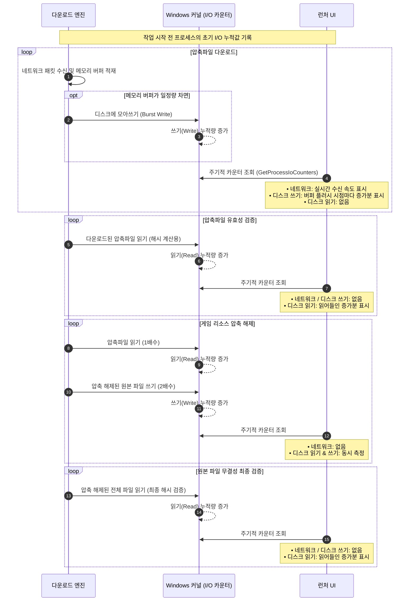
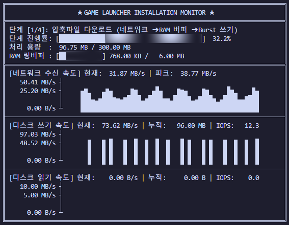
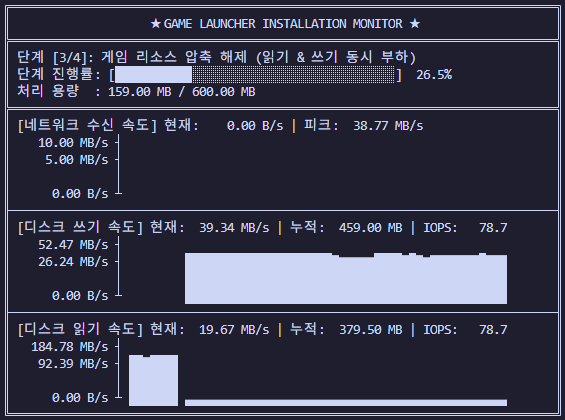

## 다운로드 시각화 고도화
이직 후 맡은 첫 업무는 게임 런처의 다운로드 시각화를 고도화하는 일이었다. 기존 런처의 투박한 꺾은선 그래프를 부드러운 곡선으로 다듬고, 스팀처럼 네트워크 다운로드 속도뿐만 아니라 디스크 읽기/쓰기 사용량도 함께 보여주기로 했다. 유저에게 "지금 런처가 열심히 일하고 있다" 는 걸 직관적으로 보여주기 위함이었다.
 
 

## 익숙했던 WMI 도입
디스크 사용량을 어떻게 수집할까 고민하다가, 이전 보안 회사에서 자주 쓰던 WMI(Windows Management Instrumentation를 선택했다. 이미 써본 기술이라 구현도 문제없이 빨랐다. 

다운로드 엔진이 거치는 4단계(다운로드 → 압축파일 유효성 확인 → 압축 해제 → 원본파일 유효성 확인) 에 WMI 기반 측정 로직을 추가했고, 사내 테스트에서도 그래프가 잘 그려지는 것을 확인한 뒤 정기 배포에 포함시켰다. 이때까지만 해도 첫 배포가 성공적인 줄 알았다.
 
 

## 배포 직후 70%로 떨어진 정상 세션 비율
배포 후 얼마 지나지 않아 Slack 에 평상시와 다른 Sentry 알림이 날아왔다.

평소 99% 를 유지하던 이 정상 세션 비율이 배포 직후, 70% 근처까지 곤두박질치고 있었다. 크래시로 이어지지 않도록 예외 처리를 해두고, 실패 시 Sentry 로 전송하도록 구현해 둔 덕분에 런처가 강제 종료되거나 다운로드가 막히는 불상사는 없었다. 하지만 30% 에 달하는 세션에서 에러가 찍히고 있었고, Sentry 에 수집된 로그와 사용자 환경 정보를 추적해 보니 원인은 WMI 객체 생성 자체가 실패하고 있었고, 게임 성능을 조금이라도 더 확보하기 위해 백그라운드의 WMI 서비스를 강제로 꺼두고 쓰는 유저가 있었던 것이다.
 
 

## 기업용 보안 솔루션과 게이밍 PC 환경의 차이
이전 회사의 보안 제품은 '기업용 PC'가 주 대상이었다. 보안 에이전트가 초기화될 때, 만약 필수라 정해둔 서비스가 꺼져 있으면 강제로 활성화하는 로직이 초기화시 작성되어있다. 즉, 이전에는 "WMI 는 언제나 켜져 있다" 가 당연한 상식이었고, WMI 가 꺼진 환경을 마주할 일 자체가 없었다.

통제가 되는 기업 환경의 전제를, 사용자의 커스텀이 당연하게 이루어지는 게이밍 도메인에 아무런 의심 없이 그대로 가져온 것이 문제였다. 임의로 유저 PC 의 WMI 를 켤 수는 없기때문에 OS가 제공하는 서비스에 기대는 대신, 다운로드 엔진이 이미 알고 있는 값 을 쓰기로 했다.

파일을 내려받고 압축을 풀고 검증하는 주체는 결국 다운로드 엔진이다. 각 단계에서 실제로 읽어들인 바이트와 디스크에 기록한 바이트 크기를 직접 집계해 그래프 데이터로 넘겨주는 방식으로 빠르게 핫픽스 배포했고, 세션 지표는 다시 99%대의 안정을 되찾았다.
 
 

## 생각치 못했던 해결법과 검증
당시에는 빠른 수습을 위해 엔진 내부의 파일 처리량을 직접 계산했지만, 다시 같은 요구사항을 구현한다면 WMI 대신 Win32 API인 `GetProcessIoCounters` 를 사용할 것이다.

당시 다운로드 엔진은 정적 라이브러리 형태로 런처와 같은 프로세스 안에서 동작했기 때문에, 현재 프로세스의 I/O 카운터만 읽어오면 구현이 훨씬 깔끔해진다. 실제로 이 방식이 유효한지 검증하기 위해, 런처의 4단계 파이프라인을 모사한 시뮬레이터를 작성해 테스트해 보았다.

|네트워크 사용량|디스크 I/O 처리량|
|---|---|
|||

하드웨어 모니터링 툴이 아니라  "사용자가 체감하는 런처의 작업 진행 속도" 를 시각화해 주는 목적이라면, 오히려 이 방식이 더 적합하고 안정적인 선택지라고 생각한다.

