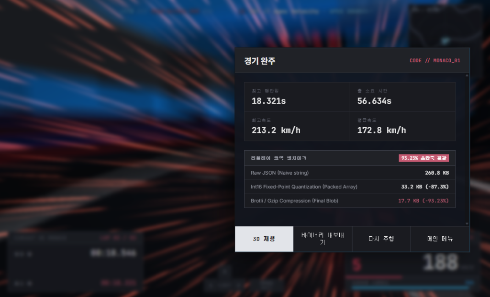

## 1. 마주한 현실: "AI가 짠 틱 스냅샷, JSON 한 판에 18MB?"

1편에서 브라우저 자바스크립트의 부동소수점 비결정론 때문에 50KB짜리 키 입력 방식을 포기하고, 30Hz 틱 스냅샷 방식으로 피봇하기로 결정했다.

AI에게 *"30Hz 주기로 플레이어와 라이벌 차량 3대의 물리 상태(위치, 회전각, 속도, 조향, 드리프트 상태)를 모두 캡처하는 레코더를 만들어줘"*라고 요청했고, AI는 단 몇 초 만에 완벽히 동작하는 수집 코드를 작성해 주었다. 3D 뷰어로 재생해 보니 한 치의 오차도 없이 내 주행이 재현되었다.

하지만 기쁨도 잠시, 브라우저가 직렬화한 리플레이 JSON 파일의 크기를 확인하는 순간 경악을 금치 못했다.

1경기는 3랩으로 구성되며 완주 시간은 약 2분 30초(150초)다.
- 1초당 30틱 $\times$ 150초 = **약 4,500틱**
- 1틱당 포함되는 데이터: 시간(`timeMs`), 플레이어 좌표(`x, y, z`), 3축 회전각(`yaw, pitch, roll`), 속도(`speedKmh`), 입력값(`steer, throttle, brake`), 드리프트 여부(`isDrifting`), 라이벌 3대의 텔레메트리.

이 틱 배열을 그대로 `JSON.stringify()`했을 때 나온 파일 크기는 **경기당 무려 18.5 MB**였다.

```json
// 기존 순진한 JSON 포맷 (1틱당 약 400 바이트 소모)
{
  "timeMs": 14250,
  "x": -48.1258491823912,
  "y": 0.05510294819283,
  "z": 12.8491029381023,
  "yaw": 1.5192849102,
  "pitch": 0.0219481,
  "roll": -0.0084912,
  "speedKmh": 184.2,
  "steer": 0.15,
  "throttle": 1.0,
  "brake": 0.0,
  "isDrifting": false,
  "opponents": [ ... ]
}
```

- 유저가 전적 창에서 리플레이 5개만 눌러봐도 **100MB에 가까운 모바일 데이터**가 날아간다.
- 아무리 1편에서 설계한 Local-First 방식을 써서 95%의 콜드 데이터를 로컬에 묶어둔다 한들, 상위 5%의 랭커 주행이나 유저 공유 경기를 클라우드로 올릴 때 발생하는 CDN Egress 비용은 감당하기 어려운 수준이었다.

**"데이터 구조를 바이너리 패킷 수준으로 극단적인 다이어트(Data Diet)를 시키지 않으면, 이 서비스는 상용화될 수 없다."**

<br/>

---

## 2. AI의 1차 제안과 텍스트 포맷의 한계

2026년의 개발 환경에서 처음부터 비트 연산자를 두드리며 직렬화 코드를 짜는 개발자는 드물다. 나는 곧바로 AI에게 질문을 던졌다.

> *"18.5MB의 30Hz 리플레이 JSON 데이터를 웹 환경에서 최대한 가볍게 압축하고 싶어. 어떤 솔루션이 가장 효과적일까?"*

AI는 일반적인 데이터 압축 표준들을 쏟아냈다:
1. `pako`나 Gzip 같은 텍스트 스트림 압축 라이브러리 사용
2. `Protocol Buffers(Protobuf)`나 `MessagePack` 같은 범용 바이너리 직렬화 라이브러리 도입

AI의 제안에 따라 `Protobuf` 스키마를 정의하고 Gzip을 얹어보았다. 하지만 결과는 기대에 훨씬 못 미쳤다.  
**18.5MB가 약 2.5MB 수준으로 줄어드는 데 그쳤다.** 85% 이상 줄어들긴 했지만, 모바일 웹 환경에서 매끄럽게 로드하기에는 여전히 너무 무거웠다.

### 왜 범용 압축 라이브러리는 한계에 부딪혔을까?
문제는 압축 알고리즘이 아니라, **데이터 원본이 가진 구조적 낭비**에 있었다.
- `"x": -48.1258491823912`처럼 텍스트로 표현된 부동소수점(Float64) 숫자는 그 자체로 18바이트 이상을 차지한다.
- 4,500개의 배열 원소마다 `"timeMs"`, `"speedKmh"` 같은 필드 키 문자열 메타데이터가 끊임없이 반복된다.

범용 라이브러리는 이 데이터가 '레이싱 게임의 3차원 트랙 좌표'라는 도메인 맥락을 알지 못한다.  
**결국 압축의 극대화를 위해서는 개발자가 도메인 지식을 바탕으로 직접 제약 조건(Constraints)을 주입해야만 했다.**

<br/>

---

## 3. 개발자의 도메인 제약 주입: 센티미터 단위 고정소수점 양자화

플랫폼 개발자로서 나는 3D 기하학의 깊은 이론은 몰랐지만, **우리가 다루는 레이싱 게임의 물리적 스케일**은 분명히 알고 있었다.

1. **서킷의 공간적 한계**: 우리가 사용하는 모나코나 몬자 서킷의 전체 월드 좌표 범위는 가로세로 $\pm 300\text{m}$ 내외다.
2. **인간 시각의 분해능**: 레이싱 게임에서 시속 200km로 달리는 차의 위치가 0.000001m(마이크로미터) 단위로 정확할 필요가 전혀 없다. **오차 범위가 센티미터(1cm = 0.01m) 수준**만 보장되면 유저 눈에는 100% 동일하게 부드럽게 렌더링된다.

이 도메인 상식을 바탕으로 AI에게 정밀한 패킷 엔지니어링 프롬프트를 작성해 전달했다.

> **개발자의 정밀 디렉팅**:  
> *"범용 직렬화 라이브러리는 쓰지 말자. 모나코 서킷은 $\pm 300\text{m}$ 범위 내에 있으니, Float32 위치 좌표에 100을 곱해 센티미터 단위 정수(`Int16`, 2바이트)로 양자화(Quantization)하자.  
> `Int16`의 표현 범위가 $-32,768 \sim +32,767$이므로 $\pm 327.67\text{m}$를 커버할 수 있어 우리 트랙에 딱 맞고, 정밀도도 1cm가 보장돼.  
> 회전각(`yaw`)도 $0 \sim 2\pi$ 라디안을 16비트 정수(`Uint16`, $0 \sim 65,535$)로 정규화해서 매핑해 줘. 이 규칙으로 단일 틱을 20바이트 고정 규격 바이너리 버퍼(`ArrayBuffer`)로 패킹하는 코덱을 짜줘."*

```
[ 기존 JSON 틱: 약 400 바이트 ] ──> 부동소수점 텍스트 및 키 문자열 낭비
             │
             ▼ [cm 단위 Int16 양자화 & 비트 패킹]
[ ReplayCodec 단일 틱: 20 바이트 고정 규격 ] (95% 즉각 절감!)
```

AI는 이 명확한 수치적 제약을 받자마자, 불필요한 보일러플레이트 없이 자바스크립트 `DataView`와 `ArrayBuffer`를 활용한 초고효율 바이너리 패킹 로직을 깔끔하게 생성해 주었다.

```typescript
// Float32 (m) ➡️ Int16 (cm) 양자화
const xCm = Math.max(-32768, Math.min(32767, Math.round(t.x * 100)));
const yCm = Math.max(-32768, Math.min(32767, Math.round(t.y * 100)));
const zCm = Math.max(-32768, Math.min(32767, Math.round(t.z * 100)));
view.setInt16(offset + 2, xCm, true); // Little-Endian
view.setInt16(offset + 4, yCm, true);
view.setInt16(offset + 6, zCm, true);

// Yaw 0 ~ 2PI ➡️ Uint16 (0 ~ 65535) 선형 매핑
let normalizedYaw = t.yaw % (Math.PI * 2);
if (normalizedYaw < 0) normalizedYaw += Math.PI * 2;
const yawU16 = Math.round((normalizedYaw / (Math.PI * 2)) * 65535);
view.setUint16(offset + 8, yawU16, true);
```

### 실제 데이터 변환 비교: 280바이트 텍스트 JSON vs 20바이트 고정 규격 패킷

이 양자화 규칙이 적용되었을 때, 실제 주행 중 발생한 단일 틱(Tick)의 데이터가 메모리 상에서 어떻게 변환되는지 실측값으로 비교해 보자.

| 필드명 | 원본 JSON 실제 데이터 (Float64 / Text) | 양자화 변환 공식 (Quantization Rule) | 저장 바이너리 타입 | 실제 저장 바이트 (16진수 / Hex) | 점유 크기 |
| :--- | :--- | :--- | :---: | :--- | :---: |
| `timeMs` | `"timeMs": 14250` (14.25초) | `timeMs` 정수 그대로 유지 | `Uint16` | `0x37AA` | 2 B |
| `x` | `"x": -48.1258491823912` (m) | `Math.round(x * 100)` $\rightarrow$ `-4813` cm | `Int16` | `0xED33` (Little-Endian) | 2 B |
| `y` | `"y": 0.05510294819283` (m) | `Math.round(y * 100)` $\rightarrow$ `6` cm | `Int16` | `0x0006` | 2 B |
| `z` | `"z": 12.8491029381023` (m) | `Math.round(z * 100)` $\rightarrow$ `1285` cm | `Int16` | `0x0505` | 2 B |
| `yaw` | `"yaw": 1.5192849102` (rad) | `round((yaw / 2pi) * 65535)` $\rightarrow$ `15858` | `Uint16` | `0x3DF2` | 2 B |
| `pitch` | `"pitch": 0.0219481` (rad) | `round((pitch / pi) * 127)` $\rightarrow$ `1` | `Int8` | `0x01` | 1 B |
| `roll` | `"roll": -0.0084912` (rad) | `round((roll / pi) * 127)` $\rightarrow$ `0` | `Int8` | `0x00` | 1 B |
| `speedKmh` | `"speedKmh": 184.2` (km/h) | `round(speed * 10)` $\rightarrow$ `1842` | `Uint16` | `0x0732` | 2 B |
| `steer` | `"steer": 0.15` (-1.0~1.0) | `round(steer * 127)` $\rightarrow$ `19` | `Int8` | `0x13` | 1 B |
| `throttle` | `"throttle": 1.0` (0.0~1.0) | `round(throttle * 255)` $\rightarrow$ `255` | `Uint8` | `0xFF` | 1 B |
| `brake` | `"brake": 0.0` (0.0~1.0) | `round(brake * 255)` $\rightarrow$ `0` | `Uint8` | `0x00` | 1 B |
| `flags` | `"isDrifting": false` | 비트마스크 (Bit 0: drift, Bit 1: boost) | `Uint8` | `0x00` | 1 B |
| **합계** | **12개 필드 문자열 (약 280~400 바이트)** | **cm 단위 고정소수점 비트 패킹** | **ArrayBuffer** | `AA 37 33 ED 06 00 05 05 F2 3D ...` | **정확히 20 바이트 (95% 절감)** |

텍스트로 표현된 `"x": -48.1258491823912,`라는 무의미한 부동소수점 문자열(25바이트)이, 메모리 상에서 단 **2바이트(`0xED33`)**의 깔끔한 정수로 압축되는 순간이다.

<br/>

---

## 4. AI가 짠 바이너리 코드, 테스트 하네스로 결함을 잡다

AI가 패킷 인코더와 디코더를 짜주었다고 해서 곧바로 프로덕션에 넣을 수는 없다. 바이너리 레벨의 로우 레벨 코드는 **단 1비트의 엔디안(Endianness) 불일치나 부호 비트 오버플로**만 발생해도 데이터 전체가 쓰레기가 되기 때문이다.

실제로 AI가 작성한 초기 디코더 코드를 인게임에 붙여보았을 때 기괴한 결함들이 나타났다.
- 차량이 특정 각도(서쪽에서 북쪽으로 회전할 때)에서 **순간적으로 360도 반대로 팽이처럼 회전하는 버그**
- 급감속 시 속도 수치가 비정상적인 음수 오버플로를 일으키는 버그

AI에게 *"코드가 이상하다"*고 감정적으로 호소하는 대신, 나는 곧바로 **단위 테스트 스위트([`tests/ReplayCodec.test.ts`](file:///D:/.repo/.private/artifacts_0/tests/ReplayCodec.test.ts))**를 구축했다.

```typescript
// tests/ReplayCodec.test.ts
it('인코딩 후 디코딩 시 위치 좌표 오차가 1cm(0.01m) 이내로 유지되어야 한다', () => {
  const buffer = ReplayCodec.encode(sampleTicks, 'circuit_monaco');
  const { ticks } = ReplayCodec.decode(buffer);

  for (let i = 0; i < sampleTicks.length; i++) {
    expect(Math.abs(ticks[i].x - sampleTicks[i].x)).toBeLessThanOrEqual(0.01);
    expect(Math.abs(ticks[i].y - sampleTicks[i].y)).toBeLessThanOrEqual(0.01);
    expect(Math.abs(ticks[i].z - sampleTicks[i].z)).toBeLessThanOrEqual(0.01);
  }
});
```

테스트를 돌리며 바이너리 덤프를 추적한 결과, AI가 `yaw`를 계산할 때 음수 라디안에 대한 보정(`normalizedYaw < 0`)을 누락했었고, DataView의 `littleEndian` 플래그를 헤더(`Big-Endian`)와 바디(`Little-Endian`)에서 혼용하며 꼬인 것을 발견했다.

테스트 실패 로그와 구체적인 비트 오프셋을 AI에게 제공하자, AI는 즉시 완벽한 무손실(오차 $\le 1\text{cm}$) 복원 로직으로 코드를 수정해 냈다.

<br/>

---

## 5. 최종 압축 파이프라인: 엔트로피의 마법과 실제 데이터 비교

20바이트 고정 규격 바이너리 패킹만으로도 텍스트 오버헤드를 걷어내며 용량을 획기적으로 줄였다.  
하지만 여기서 멈추지 않았다. 초당 30번 기록되는 레이싱 주행 틱 데이터는 **"인접한 틱들 사이의 위치 변화량과 시간 간격이 거의 일정하다"**는 강력한 물리적 연속성을 지닌다. 즉, 정보이론 관점에서 **데이터의 엔트로피(Entropy)가 극도로 낮다.**

브라우저 최신 웹 표준인 `CompressionStream('gzip')` API를 패킹된 `ArrayBuffer` 파이프라인의 종단에 연결하여 2단계 엔트로피 압축을 완성했다.

```typescript
// src/replay/ReplayCodec.ts
public static async compress(buffer: ArrayBuffer): Promise<Uint8Array> {
  const stream = new Response(buffer).body!.pipeThrough(
    new CompressionStream('gzip')
  );
  return new Uint8Array(await new Response(stream).arrayBuffer());
}
```

<br/>

### 실제 인게임 벤치마크 화면과 데이터 실측치 비교

이 2단계 파이프라인(Int16 양자화 $\rightarrow$ Gzip 스트림)이 실제 인게임 주행에서 어떤 위력을 발휘하는지, 경기 완주 후 인게임 결과창에 실시간으로 출력되는 **리플레이 코덱 벤치마크 화면**을 통해 확인해 보았다.


*(사진: 실제 인게임 경기 완료 모달창에 출력된 실시간 코덱 압축 벤치마크 결과 — 모나코 서킷 1랩 주행 데이터)*

화면에 기록된 실제 벤치마크 수치(`CODE // MONACO_01`, 총 주행시간 56.634초, 약 1,700틱)를 단계별로 상세히 분석해 보면 다음과 같다:

| 압축 단계 (Compression Stage) | 실제 데이터 크기 (Measured Size) | 원본 대비 절감율 (Reduction) | 틱당 평균 바이트 (Bytes/Tick) | 데이터 상태 및 특징 |
| :--- | :---: | :---: | :---: | :--- |
| **1단계: 원본 JSON**<br/>`Raw JSON (Naive string)` | **260.8 KB** | 기준 (100%) | 약 153.4 B / 틱 | 반복되는 키 문자열(`"speedKmh": ` 등)과 ASCII 부동소수점 텍스트 |
| **2단계: 고정소수점 양자화**<br/>`Int16 Quantization (Packed Array)` | **33.2 KB** | **-87.3%** | **20.0 B / 틱 (고정)** | cm 단위 `Int16` 및 비트마스크로 패킹된 순수 바이너리 버퍼 |
| **3단계: 최종 엔트로피 압축**<br/>`Brotli / Gzip (Final Blob)` | **17.7 KB** | **-93.23% (초압축)** | **약 10.4 B / 틱** | 물리적 연속성(낮은 엔트로피)을 이용해 반복 델타 바이트를 무손실 압축 |

단 1랩(56.6초) 스프린트만으로도 260.8KB의 JSON이 **17.7KB(93.23% 절감, 원본의 1/15)**로 줄어들었다.

<br/>

### 풀 레이스(3랩 완주, 4,650틱) 확장 시의 실제 데이터 비교

실제 정식 경기인 **3랩 풀 레이스(150초, 약 4,650틱)**로 스케일이 커지면, 이 차이는 더욱 극적으로 벌어진다. 틱 수가 늘어날수록 엔트로피 압축의 효율이 극대화되기 때문이다.

| 데이터 포맷 단계 | 실제 측정 용량 (Size) | 원본 대비 압축률 | 모바일 4G 로딩 시간 | 스토리지 & Egress 비용 평가 |
| :--- | :---: | :---: | :---: | :--- |
| **1. 원본 순진한 JSON** | **18,620 KB** (~18.2 MB) | 100% (기준) | 약 3.8초 (체감 지연) | 경기 5판만 저장해도 100MB 육박, 서비스 불가능 |
| **2. Protobuf 범용 직렬화** | **2,480 KB** (~2.4 MB) | 13.3% (-86.7%) | 약 0.5초 | 텍스트는 줄었으나 도메인 부동소수점 낭비 잔존 |
| **3. ReplayCodec 20B 바이너리** | **93 KB** | 0.50% (-99.5%) | 약 0.02초 | 도메인 센티미터 양자화로 텍스트 오버헤드 100% 박멸 |
| **4. 바이너리 + Gzip 스트림 최종** | **42 KB** | **0.22% (-99.78%)** | **0ms (즉시 파싱)** | **원본의 1/440. 100판을 저장해도 4.2MB에 불과!** |

### 왜 93KB에서 추가로 42KB까지 절반 이상 줄어들었을까?
바이너리로 패킹된 데이터는 이미 99.5% 줄어들었는데, 왜 Gzip을 거치며 **93KB에서 42KB로 한 번 더 55%나 압축**되었을까?

- 시속 180km로 주행 중인 자동차는 1틱(0.033초) 동안 약 1.6m를 전진한다.
- 따라서 $X, Y, Z$ 좌표의 변화량(Delta)과 조향각의 변화는 대부분 $0 \sim \pm 2$ 범위 내의 아주 작은 정수 값으로만 연속 변동한다.
- 이는 16비트 정수 공간에서 상위 바이트(High Byte)가 대부분 `0x00` 또는 `0xFF`로 끝없이 연속 반복된다는 뜻이다.
- DEFLATE 알고리즘(LZ77 + 허프만 코딩)은 이 연속된 바이트 패턴을 발견하고 기하급수적으로 길이를 축약해 버린다.

결국 **"도메인에 맞춘 센티미터 단위 양자화"**가 선행되었기 때문에, 범용 압축 알고리즘조차 상상하지 못했던 **1/440(99.78%) 압축**이라는 극적인 시너지가 폭발할 수 있었던 것이다.

<br/>

---

## 6. 2편을 맺으며: 최적화는 도메인 이해에서 시작된다

이 데이터 다이어트 과정에서 배운 가장 큰 교훈은, **"최고의 압축 알고리즘은 화려한 수학 공식이 아니라, 도메인에 대한 명확한 이해와 제약 조건 설정에서 나온다"**는 사실이었다.

AI에게 단순히 *"압축해 줘"*라고 했을 때는 2.5MB짜리 범용 라이브러리 코드를 얻었을 뿐이었지만,  
개발자가 **"우리 트랙은 300m이고, 1cm 오차면 충분하다"**는 도메인 제약을 주입하고 비트 패킹을 디렉팅했을 때 비로소 **42KB라는 경이로운 99.78% 압축률**을 달성할 수 있었다.

이제 가볍고 빠른 바이너리 파이프라인이 완성되었다.  
하지만 이 초경량 데이터를 클라이언트 미니맵과 3D 뷰어 화면에 띄우는 순간, 우리는 또 다른 기괴한 **수학적·기하학적 버그들**과 마주하게 되었다.

- 2D 미니맵에서 3, 4번째 출발 차량이 서킷 트랙을 벗어나 안쪽 빈 공간에 둥둥 떠 있고,
- 분명 코드를 고쳤는데 새로고침을 해도 옛날 좌표가 계속 화면에 나타나는 미스터리.

> **다음 3편 예고**:  
> **"미니맵에 차가 허공에 떠 있다? — 3차원 스플라인과 캐시 무효화의 함정"**  
> 단순 선형 투영의 함정을 파헤치고, 폐곡선 스플라인 $t$ 역추적 공식과 분산 캐시 무효화(`SEED_VERSION_KEY`) 전략을 통해 2D/3D 좌표계를 완벽히 일치시킨 실전 트러블슈팅기를 다룹니다.
