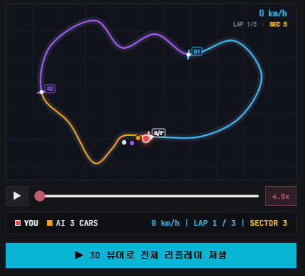
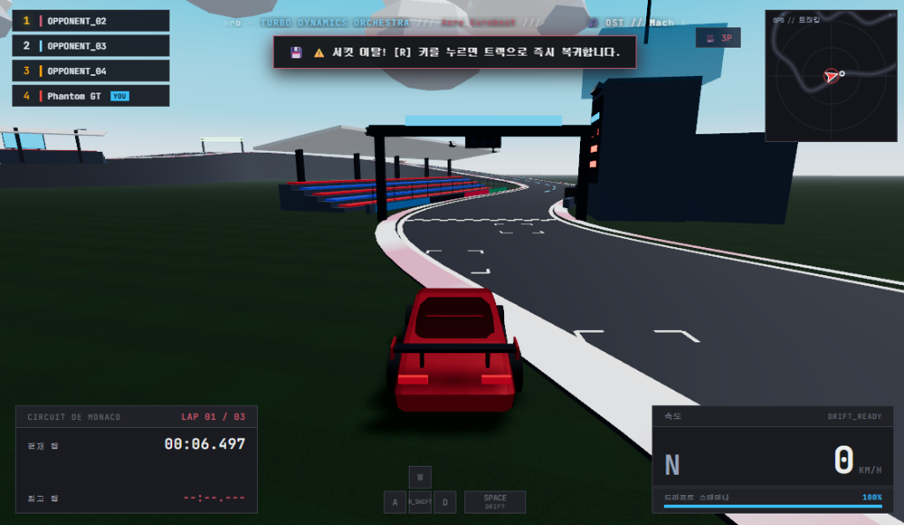
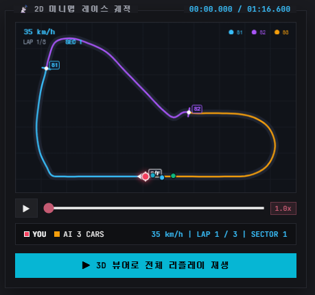

## 1. 완벽해 보였던 시스템과 기묘한 버그의 출현

2편에서 완성한 고정소수점 양자화 바이너리 코덱([`ReplayCodec.ts`](file:///D:/.repo/.private/artifacts_0/src/storage/ReplayCodec.ts))을 통해 18.5MB에 달하던 30Hz 주행 데이터를 42KB로 압축하는 데 성공했다.

여기에 브라우저 IndexedDB 로컬 스토리지 계층을 연결하고, 웹 브라우저 화면 좌측에는 전적 목록 테이블을, 우측에는 2D 캔버스 기반 미니맵 리플레이 플레이어([`MinimapReplayPlayer.ts`](file:///D:/.repo/.private/artifacts_0/src/ui/MinimapReplayPlayer.ts))를 배치하여 전적 인스펙터 시스템을 구축했다.

이제 전적 목록에서 임의의 경기를 클릭하면, 우측 2D 서킷 궤적 위에서 4대의 차량(플레이어와 AI 라이벌 3대)이 신호등 카운트다운과 함께 부드럽게 출발해야 했다.

그런데 **모나코(Monaco) 서킷 리플레이를 재생하는 순간, 두 눈을 의심하게 만드는 기묘한 버그가 화면에 나타났다.**


*(사진 1: 2D 미니맵 출발 직후 버그 현상. 1번 빨간색 플레이어와 2번 주황색 차량은 도로 위에 서 있으나, 3번(보라색)과 4번(흰색) 차량이 트랙 아래 빈 공간에 일직선으로 둥둥 떠 있다.)*

결승선(Start/Finish) 바로 앞의 빨간색 플레이어와 2번 주황색 차량은 아스팔트 도로 선 위에 예쁘게 서 있었다.  
그런데 **3번(보라색)과 4번(흰색) 차량이 트랙 곡선을 완전히 벗어나, 트랙 안쪽 바다/빈 공간에 수평 일직선으로 둥둥 떠서 출발을 기다리고 있는 것**이었다!

단순한 2D 캔버스 렌더링 좌표 변환 오류였을까?  
이 문제를 파고들면서 마주한 것은 **AI의 겉핥기식 오진**, **3차원 공간 기하학의 함정**, **오프라인 파이프라인의 분기 오류**, 그리고 **클라이언트 분산 캐시 정합성(Cache Invalidation)의 복병**이었다.

<br/>

---

## 2. AI의 1차 진단과 오판: "캔버스 뷰포트 비율 버그입니다?"

2026년의 개발 환경에서 이런 시각적 버그를 마주했을 때, 개발자는 캔버스 수식을 한 줄씩 뜯어보기 전에 버그 스크린샷과 로그를 AI에게 전달하며 분석을 요청한다.

> *"모나코 서킷 리플레이를 재생했는데, 1번과 2번 차는 트랙 위에 있는데 3번과 4번 차가 트랙 바깥 허공에 수평으로 떠 있어. 2D 미니맵 렌더러에 무슨 버그가 있는 걸까?"*

AI는 곧바로 자신 있게 2D 캔버스 렌더링 계층의 코드를 지목했다:

> *"2D 미니맵 캔버스의 월드-스크린 좌표 투영 매핑(`scaleX, scaleY`)이나 뷰포트 종횡비(Aspect Ratio) 패딩 계산에 오차가 발생한 것 같습니다. 캔버스 리사이즈 시점의 오프셋 보정 수식을 다음과 같이 패치해 드리겠습니다."*

AI가 내놓은 패치 코드는 캔버스 크기를 다시 계산하고 뷰포트 마진을 동적으로 클램핑하는 전형적인 프론트엔드 UI 방어 코드였다.

### 눈으로 확인하는 개발자의 직관: "왜 1·2번은 멀쩡하고 3·4번만 벗어났을까?"

하지만 AI가 짜준 코드를 적용하기 전, 잠시 의문이 들었다.

- 만약 AI의 말대로 **캔버스 종횡비나 뷰포트 스케일링 공식이 틀린 것이라면**, 트랙 전체가 찌그러지거나 1번, 2번 차량도 도로에서 똑같이 빗나가야 정상이다.
- 그런데 왜 하필 **결승선에 가까운 1·2번 차량은 도로 정중앙에 정확히 서 있고, 후방에 배치된 3·4번 차량만 자로 잰 듯 수평 일직선으로 허공에 떠 있는 것일까?**

의구심이 들어 2D 캔버스 화면을 닫고, Three.js 3D 인게임 카메라 뷰를 켜서 모나코 서킷 출발 그리드 현장으로 직접 날아가 보았다.

그리고 3D 화면을 본 순간 실소를 금치 못했다.


*(사진 2: 3D 인게임 카메라로 확인한 충격적인 현장. 3번 보라색 차량과 4번 흰색 차량이 아스팔트 트랙을 벗어나 13m 바깥 잔디밭 빈 땅에 덩그러니 스폰되어 있다.)*

**버그는 2D 캔버스 렌더러의 잘못이 아니었다.**  
**애초에 3D 물리 엔진 상에서 3번과 4번 차량이 실제 도로 바깥 13m 잔디밭 땅바닥에 스폰되어 있었던 것이다!**

2D 미니맵은 3D 공간에 실제로 존재하는 차량의 월드 좌표를 단지 정직하게 투영해서 보여주었을 뿐이었다. AI의 성급한 진단만 믿고 캔버스 렌더링 수식을 뜯어고쳤다면, 멀쩡한 렌더러만 망가뜨린 채 미궁에 빠질 뻔한 순간이었다.

<br/>

---

## 3. [시행착오 1] 선형 역투영의 함정과 3D 스플라인(Spline) $t$ 역추적

그렇다면 도대체 왜 3번과 4번 차량만 잔디밭에 스폰되었을까?  
초기 출발 그리드(Starting Grid) 배치 로직을 확인해 보았다.

### 버그의 근본 원인: 순진한 선형 역투영 (Linear Reverse Projection)

과거 출발 그리드 배치 코드는 대단히 직관적이고 단순하게 작성되어 있었다:

> *"출발선 위치(`startPt`)에서 출발선의 진행 방향 접선 벡터(`startTangent`)의 반대 방향으로 후방 거리(`distBehind`: 5m, 16m, 27m, 38m)만큼 빼주면 그리드 위치가 나오겠지?"*

```typescript
// 과거 구형 코드의 치명적 오류 (선형 역투영)
const pos = sfPos.clone().sub(startTangent.clone().multiplyScalar(slot.distBehind));
```

이 공식은 몬자(Monza)나 실버스톤(Silverstone)처럼 결승선 앞뒤로 수백 미터의 긴 직선 메인 스트레이트(Straight) 주로가 시원하게 뻗어 있는 서킷에서는 아무런 문제가 없었다. 직선 주로에서는 접선 벡터를 따라 뒤로 가도 여전히 아스팔트 도로 위이기 때문이다.

하지만 **모나코 서킷은 달랐다.**  
모나코 서킷의 결승선 바로 직전은 유명한 마지막 코너인 **앙토니 노게스(Anthony Noghès) 헤어핀을 돌아 나오는 급격한 곡선 주로**다.

```
[Anthony Noghès 급커브] ── 곡선 트랙 (Z=20~40m) ──> [결승선 S/F (Z=0m)]
                                 │
           (선형 역투영 시) ◀─────┴───── Z=0 수평 직선으로 -38m 투영!
                                          ==> 트랙 바깥 잔디밭/바다로 추락!
```

결승선 통과 시점의 접선 벡터는 $X$축을 향하고 있었는데, 결승선 뒤쪽의 실제 도로는 $Z$축 방향으로 급격하게 꺾여 올라가고 있었다.

이 상황에서 접선 벡터 반대 방향으로 단순 직선 역투영을 하니:
- 1번 슬롯 (5m 뒤): 곡선이 시작되기 직전이라 아스팔트 위에 안착
- 2번 슬롯 (16m 뒤): 도로 가장자리 턱걸이 안착
- **3번 슬롯 (27m 뒤)**: 실제 커브 도로($Z \approx 25\text{m}$)를 벗어나 잔디밭($Z \approx 0\text{m}$)에 스폰
- **4번 슬롯 (38m 뒤)**: 도로 바깥 **13m 떨어진 잔디밭 허공**에 스폰

모나코 서킷의 아스팔트 폭은 13.5m(중앙선 기준 좌우 6.75m)인데, 13m나 빗나갔으니 완전히 트랙 바깥으로 튕겨 나간 것이었다.

### 개발자의 기술적 디렉팅: "트랙은 직선이 아니다. 폐곡선 스플라인을 거슬러 올라가라"

문제의 원인을 파악한 나는 AI에게 기하학적 해결 방향을 명확하게 제시했다.

> **개발자의 정밀 디렉팅**:  
> *"선형 벡터 뺄셈을 즉시 폐기해. 서킷은 직선이 아니라 닫힌 3차원 캣멀-롬 스플라인(Catmull-Rom Spline) 곡선이야.  
> 결승선($u = 1.0$ 또는 $0.0$)으로부터 슬롯별 후방 거리(`distBehind`)를 서킷 전체 호 길이(`totalLength`)로 나눈 비율만큼 곡선 매개변수 $u$를 거슬러 올라가야 해.  
> 곡선 위 해당 $u$ 지점의 3D 중심점(`getPointAt(u)`)을 구하고, 그 지점의 접선 벡터(`getTangentAt(u)`)로부터 법선 벡터(`right`)를 계산해서 좌우 그리드 레인 오프셋($\pm 2.2\text{m}$)을 더하는 방식으로 [`Circuit.ts`](file:///D:/.repo/.private/artifacts_0/src/game/Circuit.ts)와 [`circuits.ts`](file:///D:/.repo/.private/artifacts_0/src/data/circuits.ts)를 수정해 줘."*

AI는 이 기하학적 수식을 전달받자마자 즉시 정밀한 스플라인 역추적 코드를 구현해 주었다.

```typescript
// src/game/Circuit.ts 및 src/data/circuits.ts 반영
export function getGridPosition(
  curve: THREE.CatmullRomCurve3,
  slotIndex: number,
  circuitWidth: number
): { position: THREE.Vector3; heading: number } {
  const slot = STARTING_GRID_SLOTS[slotIndex];
  const totalLength = curve.getLength();

  // 1. 호 길이(Arc-length) 비율만큼 폐곡선을 거슬러 올라간 매개변수 u 역추적 (순환 보정)
  const u = ((1.0 - (slot.distBehind / totalLength)) % 1.0 + 1.0) % 1.0;

  // 2. 해당 지점의 3D 중심 좌표 및 주행 방향 접선 벡터 산출
  const centerPos = curve.getPointAt(u);
  const tangent = curve.getTangentAt(u).normalize();

  // 3. 접선 벡터의 수직 법선(Right Vector) 산출 (Y축 불변)
  const right = new THREE.Vector3(-tangent.z, 0, tangent.x).normalize();

  // 4. 중앙선 기준 좌우 교차 레인 오프셋 (±2.2m) 적용
  const position = centerPos.clone().addScaledVector(right, slot.lane);
  const heading = Math.atan2(tangent.x, tangent.z);

  return { position, heading };
}
```

### 테스트 하네스를 통한 1차 검증

AI가 작성한 수학 공식이 모나코 서킷의 모든 그리드 슬롯을 도로 폭 안에 완벽히 안착시키는지 검증하기 위해, 단위 테스트([`tests/circuits.test.ts`](file:///D:/.repo/.private/artifacts_0/tests/circuits.test.ts))를 실행했다:

```typescript
// tests/circuits.test.ts
it('모나코 서킷의 모든 그리드 슬롯 위치가 트랙 아스팔트 폭(13.5m) 내에 안착해야 한다', () => {
  const def = CIRCUIT_DEFINITIONS.circuit_monaco;
  const curve = new THREE.CatmullRomCurve3(def.controlPoints, true, 'centripetal');
  const halfWidth = def.circuitWidth / 2; // 6.75m

  STARTING_GRID_SLOTS.forEach(slot => {
    // ... 스플라인 역추적 좌표 산출 ...
    const distFromCenter = pos.distanceTo(centerPos);
    expect(distFromCenter).toBeCloseTo(Math.abs(slot.lane), 2);
    expect(distFromCenter).toBeLessThan(halfWidth);

    // 최소 4.0m 이상의 안전 아스팔트 여유 마진 확인
    const margin = halfWidth - distFromCenter;
    expect(margin).toBeGreaterThanOrEqual(4.0);
  });
});
```

- 결과: 4대 차량 모두 도로 가장자리로부터 **최소 4.55m 이상의 안전 여유 마진**을 확보하며 아스팔트 정중앙에 완벽하게 안착되었다.
- 3D 인게임 뷰에서 확인해 보아도 모나코 서킷의 앙토니 노게스 헤어핀 곡면을 따라 4대의 차량이 아름다운 2x2 대열로 정확히 정렬되었다.

<br/>

---

## 4. [시행착오 2] 인게임은 고쳤는데 2D 미니맵은 왜 그대로인가? — 플랫폼 개발자의 '캐시 무효화' 본능

3D 인게임 엔진의 물리 스폰을 완벽히 수정했으니 모든 문제가 끝났다고 생각했다.  
하지만 다시 브라우저를 열고 전적 인스펙터의 2D 미니맵 리플레이를 재생한 순간, **머리가 멍해졌다.**

**2D 미니맵에서는 여전히 3·4번 차량이 트랙 아래 허공에 일직선으로 떠 있었던 것이다.**

*"인게임 물리 코드를 고쳤고, 테스트도 통과했는데... 왜 전적 미니맵에서는 여전히 옛날 버그 좌표가 나오는 거지?"*

여기서 또다시 AI에게 *"미니맵이 아직도 안 고쳐졌어"*라고 묻는다면, AI는 또다시 캔버스 코드를 의심하며 헛다리를 짚을 것이 뻔했다.  
나는 시스템의 전체 데이터 파이프라인을 처음부터 끝까지 추적해 보기로 했다.

```
[인게임 엔진 Circuit.ts] (수정 완료!)
           │
           ├── (분기 1) 실시간 주행 ──> 정상 스플라인 좌표 기록
           │
           └── (분기 2) 시드 데이터 생성기 ──> ??? (확인 필요)
                          │
                          ▼
           [정적 시드 JSON 파일] ──> ???
                          │
                          ▼
           [브라우저 IndexedDB 캐시] ──> ???
                          │
                          ▼
           [2D 미니맵 렌더러] (화면 출력)
```

이 흐름도를 따라가며 코드를 샅샅이 뒤진 끝에, **두 가지 치명적인 복병**을 밝혀냈다.

### 1) 오프라인 파이프라인의 레거시 코드 잔재
인게임 런타임 엔진([`Circuit.ts`](file:///D:/.repo/.private/artifacts_0/src/game/Circuit.ts))은 스플라인 역추적으로 깔끔하게 고쳐놓았지만, 서비스 초기 200개의 사전 경기 데이터를 일괄 생성하는 오프라인 스크립트([`scripts/generateSeedReplays.ts`](file:///D:/.repo/.private/artifacts_0/scripts/generateSeedReplays.ts))에는 과거의 선형 분기 코드가 그대로 방치되어 있었다:

```typescript
// scripts/generateSeedReplays.ts 내부에 숨어 있던 레거시 코드
if (vDist <= 0) {
  // 출발선 이전의 차량을 구형 직선 벡터로 빼버리는 코드가 독립적으로 살아있었음!
  pos.copy(startPt).addScaledVector(startTangent, vDist);
}
```

런타임 코드와 오프라인 데이터 생성 스크립트가 단일 소스(Single Source of Truth)를 공유하지 않고 복사-붙여넣기되어 있었던 탓에, 배포용 정적 시드 파일([`seed-replays.json`](file:///D:/.repo/.private/artifacts_0/data/seed-replays.json))에는 3·4번 차량의 시작 위치가 $Z \approx 9\text{m}$라는 비정상 좌표로 고스란히 구워져(Baked) 있었던 것이다.

곧바로 오프라인 스크립트도 런타임과 동일한 스플라인 추종 로직으로 교체하고 시드 데이터를 다시 빌드했다.

### 2) 클라이언트 분산 캐시 무효화 (Cache Invalidation)의 함정
하지만 진짜 복병은 따로 있었다.  
스크립트를 고치고 최신 시드 JSON 파일을 새로 빌드해서 서버에 올렸음에도, **브라우저를 새로고침하면 여전히 옛날 좌표가 화면에 출력되었다.**

이 순간, 게임 플랫폼 데스크톱 클라이언트(런처/패처)를 개발하며 숱하게 겪었던 **'로컬 캐시 오염'**의 악몽이 번쩍 떠올랐다.

- 웹 브라우저의 IndexedDB는 사용자의 로컬 디스크에 영구 보존된다.
- 유저가 최초 접속했을 때, 브라우저는 구버전 시드 데이터를 IndexedDB에 저장해 두었다.
- 애플리케이션 초기화 로직은 *"IndexedDB에 이미 데이터가 있으면 네트워크 fetch를 생략한다"*는 캐시 우선 정책을 취하고 있었다.
- 결과적으로 **서버의 JSON 파일이 아무리 최신 스플라인 데이터로 바뀌었어도, 브라우저는 이미 로컬에 박혀 있는 옛날 캐시 데이터만 주구장창 읽어와 화면에 뿌리고 있었던 것**이다!

마틴 파울러(Martin Fowler)가 말했듯, *"컴퓨터 과학에서 가장 어려운 두 가지는 캐시 무효화와 이름 짓기"*라 했던가.  
웹 환경에서도 데스크톱 패처와 동일한 **원자적 캐시 버스팅(Cache Busting) 메커니즘**을 도입해야 했다.

```typescript
// src/storage/ReplaySeedService.ts
// 스플라인 그리드 좌표 패치를 반영한 새로운 버전 키 선언
const SEED_VERSION_KEY = 'apex_racing_seeded_v20_minimap_grid_fix';

export async function initSeedReplays(force: boolean = false): Promise<void> {
  const isSeeded = localStorage.getItem(SEED_VERSION_KEY);

  // 1. 버전 키가 일치하지 않으면 로컬 캐시가 오염된 것으로 판정
  if (isSeeded !== 'true') {
    console.log('[SeedService] 구버전 시드 데이터 감지. 로컬 캐시 일괄 무효화 및 퍼지 진행...');
    
    // 로컬 IndexedDB에 저장되어 있던 구버전 SEED 경기들을 원자적으로 일괄 삭제
    const existingReplays = await appDB.listReplays();
    for (const r of existingReplays) {
      if (r.matchCode.startsWith('SEED-')) {
        await appDB.deleteReplay(r.matchCode);
      }
    }

    // 2. 최신 스플라인 보정 시드 JSON을 새로 fetch하여 IndexedDB에 일괄 재주입
    const response = await fetch('./data/seed-replays.json');
    const seedRecords = await response.json();
    await appDB.saveReplaysBulk(seedRecords);

    // 3. 새 버전 키 마킹
    localStorage.setItem(SEED_VERSION_KEY, 'true');
    console.log('[SeedService] 최신 스플라인 시드 데이터 캐싱 완료.');
  }
}
```

버전 키를 갱신하자마자, 브라우저는 접속 즉시 오염된 구버전 시드 레코드를 깨끗하게 퍼지(Purge)하고 최신 스플라인 좌표 데이터를 로컬에 안착시켰다.

그리고 다시 2D 미니맵 리플레이를 재생하자, 마침내 감격스러운 화면이 나타났다.


*(사진 3: 모든 트러블슈팅이 완료된 2D 미니맵. 4대의 차량이 모나코 서킷 아스팔트 도로 선 위에 한 치의 오차도 없이 단정하게 2x2 대형으로 정렬되어 있다.)*

보라색과 흰색 차량이 허공에서 내려와, 아스팔트 도로 선 위에 완벽하게 정렬된 채 힘차게 출발했다.

<br/>

---

## 5. [보너스 트러블슈팅] 0.1초 격차의 떨림(Flutter)을 잡는 산업용 히스테리시스(Hysteresis)

스플라인과 캐시 문제를 해결하고 리플레이를 즐기던 중, 또 하나의 미세하지만 거슬리는 UX 결함이 눈에 들어왔다.

두 대의 차량이 0.1초 미만의 아슬아슬한 차이로 나란히 코너를 돌 때, **인게임 좌측 상단의 실시간 순위표(Live Leaderboard) UI에서 1위와 2위가 1초에 대여섯 번씩 미친 듯이 뒤바뀌며 깜빡이는 현상(Flutter/Jitter)**이 발생한 것이다.

### AI의 1차 제안: `setTimeout` 디바운스
AI에게 순위표 깜빡임을 방지해달라고 하자, AI는 전형적인 웹 UI식 처방인 `setTimeout` 기반의 디바운스(Debounce)를 제안했다:
> *"순위가 바뀔 때 0.5초 동안 UI 업데이트를 지연(Debounce)시키면 깜빡임을 줄일 수 있습니다."*

하지만 이 방식은 치명적인 부작용을 낳았다. 실제 레이싱 중 대형 충돌이나 스핀아웃이 발생해 순위가 완전히 역전되었는데도, 순위표 UI가 0.5초 동안 멍하니 멈춰 있다가 뒤늦게 덜컹거리며 바뀌어 인게임 현장감과 물리적 동기화를 심각하게 해쳤다.

### 플랫폼 개발자의 해결책: 산업 제어 공학의 히스테리시스(Hysteresis) 도입
온도 조절기나 전자 계측기에서 접점이 미세하게 떨릴 때 사용하는 **히스테리시스(Hysteresis, 이력현상)** 제어 알고리즘을 [`StandingsManager.ts`](file:///D:/.repo/.private/artifacts_0/src/core/StandingsManager.ts)에 직접 설계하여 AI에게 구현을 지시했다.

순위 역전을 인정하기 위한 **3단계 방어벽과 1개의 비상 우회로**를 구축했다:

```typescript
// src/core/StandingsManager.ts
// 1. 최소 물리적 마진: 앞 차보다 최소 2.0m 이상 물리적으로 앞서야 역전 심사 시작
const leadMarginProg = 2.0 / circuitLength;
const hugeMarginProg = 10.0 / circuitLength;

// [비상 우회로] 10m 이상의 대형 격차(스핀아웃, 벽 충돌)는 지연 없이 즉각 순위 교체!
if (progDiff > hugeMarginProg) {
  this.stableStandings[i] = chaser;
  this.stableStandings[i + 1] = leader;
  this.swapCooldownTimers.set(pairKey, 1.0);
  continue;
}

// 2. 시간 홀드 (Time Hold): 2.0m 이상 앞선 상태가 최소 0.5초 이상 연속 유지되어야 공식 역전 인정
if (progDiff > leadMarginProg && !inCooldown) {
  const currentPending = (this.overtakePendingTimers.get(overtakeKey) || 0) + delta;
  this.overtakePendingTimers.set(overtakeKey, currentPending);

  if (currentPending >= 0.5) {
    this.stableStandings[i] = chaser;
    this.stableStandings[i + 1] = leader;
    this.overtakePendingTimers.delete(overtakeKey);
    
    // 3. 쿨다운 락 (Cooldown Lock): 역전 직후 동일 페어 간 1.0초 동안 추가 재역전 잠금
    this.swapCooldownTimers.set(pairKey, 1.0);
  }
} else {
  // 2.0m 마진을 지키지 못하고 뒤처지면 즉시 타이머 리셋
  this.overtakePendingTimers.delete(overtakeKey);
}
```

- 미세한 부동소수점 오차나 코너링 시의 일시적인 접촉(0.5초 미만)은 순위표를 전혀 흔들지 못한다.
- 반면 통쾌한 정통 추월이나 대형 충돌 사고는 랙 없이 시원하고 즉각적으로 순위표에 반영된다.

단순한 UI 땜질 대신 상태 머신(State Machine) 기반의 제어 공학 원리를 적용함으로써, 격렬한 휠투휠(Wheel-to-wheel) 배틀 속에서도 바위처럼 견고한 실시간 순위표를 완성할 수 있었다.

<br/>

---

## 6. 3편을 맺으며: "AI는 코드를 짜지만, 공간을 관찰하고 캐시를 설계하는 것은 사람이다"

단순히 *"미니맵에 점 2개가 이상한 데 찍혀요"*라는 작은 화면 결함 하나로 시작된 여정이었다.

만약 AI의 1차 진단만 맹신했다면 2D 캔버스 뷰포트 수식을 만지작거리며 며칠 밤을 허비했을 것이다.  
하지만 **런타임 현장을 직접 눈으로 확인하는 관찰력**, **직선이 아닌 3D 스플라인 곡선이라는 기하학적 제약 주입**, 그리고 **플랫폼 개발자로서 쌓아온 클라이언트 로컬 캐시 수명주기 통제력**이 결합되었을 때 비로소 문제는 뿌리부터 명쾌하게 해결되었다.

2026년의 개발자에게 필요한 역량은 단순히 빠른 타이핑이나 구글링 실력이 아니다.  
AI가 생성한 결과물의 이상 징후를 **런타임에서 기민하게 포착하는 안목**, 문제가 발생했을 때 레이어별로 책임을 분리해 파고드는 **추적력**, 그리고 AI에게 정확한 수학적·아키텍처적 방향타를 쥐여주는 **엔지니어링 디렉팅 역량**이야말로 AI 시대에 개발자를 진정으로 빛나게 만드는 무기임을 온몸으로 체감했다.

---

> **다음 4편 예고**:  
> **"AI 시대, 개발자는 정말 병목인가? — 넥슨 기술 면접 질문 심층 복기와 엔지니어링 하네스의 본질"**  
> 1~3편의 치열했던 실전 경험을 바탕으로, 면접 당시 면접관께서 던지셨던 "AI 활용과 인간 검토 병목", "토큰 가성비와 산출물 퀄리티" 질문을 시니어 엔지니어의 관점에서 냉정하게 재분석하고, 한 단계 진화된 최적의 해답을 제시합니다.