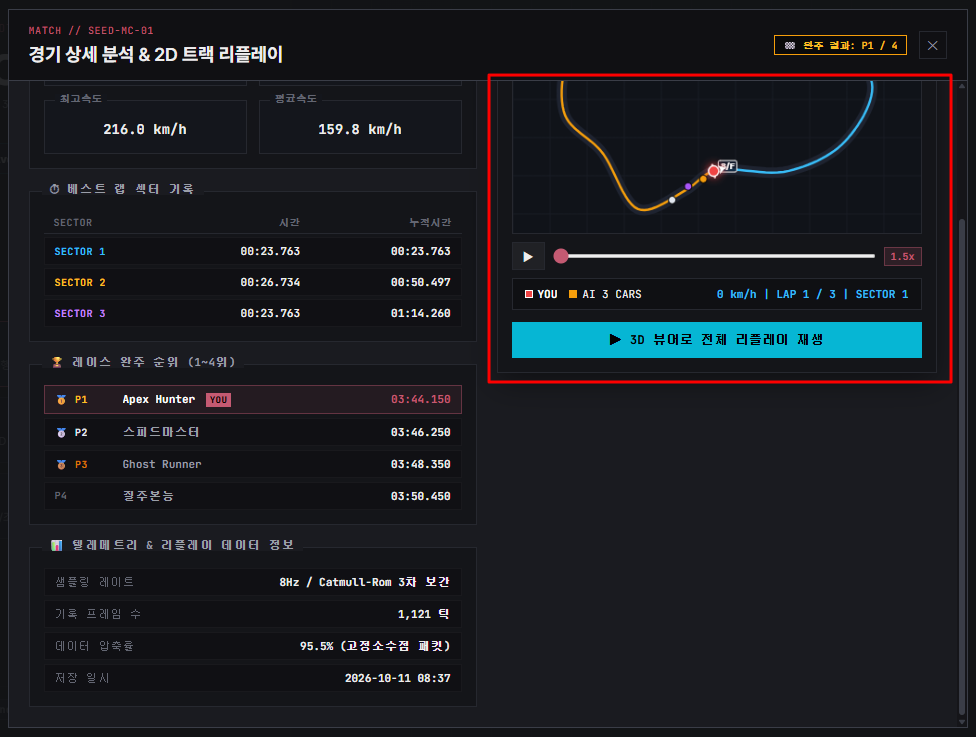
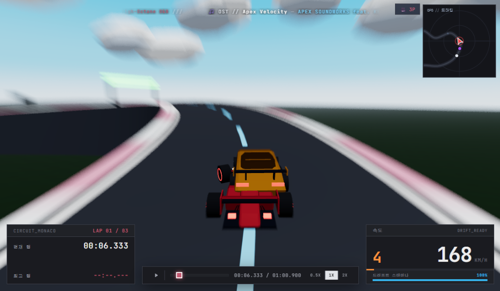

## 면접에서 마주한 질문

얼마 전 게임 서비스 부문 기술 면접에 들어갔을 때의 일이다. 지원한 곳에 추가됬으면 하는 게임 서비스에 대해 전적 서비스라고 답했다. 유저가 자신의 플레이를 복기하며 실력을 향상시키고, 멋진 명장면을 타인에게 공유하는 경험이야말로 라이브 게임의 수명을 늘리는 방법중 하나라 생각했기 때문이다. 그러자 면접관께서 곧바로 아키텍처에 대한 질문을 던지셨다.

> 라이브 게임에서 매칭마다 쏟아지는 수많은 유저들의 전적 검색과 리플레이 '데이터'는 어떻게 관리하고 서빙하는 것이 좋을까요?

따로 생각해본적 없어서 고민중에 면접관님이 캐치하셨는지 도움을 주셨다. 검색과 리플레이의 데이터 형태를 고민해보라고 하셨다. 다양한 조건으로의 검색에 적합한 메타데이터와 게임 클라이언트를 이용한 재생에 필요한 시계열 데이터를 떠올렸고 당시 나는 다음과 같이 답변했다.

> 전적 검색을 위한 메타데이터와 실제 리플레이 재생을 위한 시계열 데이터로 분리하겠습니다. 메타데이터는 인덱싱이 용이한 DB 에서 관리하고, 무거운 리플레이 데이터는 CDN 으로 캐싱합니다. 그리고 유저가 리플레이를 요청할 때만 해당 바이너리를 클라이언트로 다운로드받아, 클라이언트에서 재생하는 구조를 취하겠습니다.

면접은 끝났지만, 집으로 돌아오는 버스안에서 내 대답이 맞나싶었다.
<br/>
<br/>

## 프로덕션 위치에서 다시 생각해보자

### 리플레이 데이터는 왜 서버에 업로드되어야 하는가?

과연 다시보기위한 용도로만 쓰일까? 라이브 게임을 서비스하는 입장에서 생각해보니
- 버그 리포트가 접수되었을 때 검증을 위한 재현에 사용
- 핵/비인가 프로그램과 같이 부정행위 제재와 탐지기능 강화에 사용
- 일반적인 데이터에서는 플레이에 미칠 밸런스 패치를 위한 통계로서도 사용

즉, 운영 관점에서 리플레이 데이터는 반드시 필요할 것 같다

### 그럼 리플레이에 다운로드를 받을 필요는 없는가?
자신의 플레이를 돌려보는 것에는 그럴것이다. 하지만 다른 사람에게 '공유' 할때는 반드시 필요하다. 특히 지인에게 자신의 플레이를 자랑한다거나 스트리머에게 제보해 피드백을 받는 등 마케팅 수단으로 쓰일 수 있다.

운영을 위한 업로드가 필요하지만, 유저에게는 로컬에 저장해두는게 가장 빠르고 저렴하다. 면접장에서는 왜 단편적인 모델만 떠올렸을까? 결국 내 고민의 깊이와 준비가 부족했기 때문이라는 반성이 들었다. 그래서 말로만 끝내지 않고, 직접 전적검색 및 리플레이 서비스 프로젝트를 시작하게 됬다.
<br/>
<br/>

## 3. [시행착오 1] AI는 50KB 키 입력을 추천했다: 코드 생성과 눈으로 검증하는 개발자의 몫

AI 에이전트와 레이싱 게임을 만들고나서 원래 주제였던 질문을 던지며 시작했다.

> *"레이싱 게임의 전적검색과 리플레이를 구현하려고 합니다. 비용과 저장용량을 최소화할 수 있는 데이터 관리방식에 어떤게 있을까요?"*

AI 는 게임 업계의 대표적인 표준이라며 다음과 같이 추천해 주었다.

> *"유저가 누른 키보드/마우스 입력값(WASD, 조향각)만 기록하는 **'결정론적 락스텝(Deterministic Input Replay)'** 방식을 사용하면, 3분 경기 풀 데이터라도 **50~100KB**면 충분합니다. 키 이벤트를 기록하고 인게임 물리 루프에 재주입하는 코드를 작성해 드릴게요."*

수십 메가바이트의 좌표 대신 50KB 텍스트 파일 하나로 리플레이를 끝낼 수 있다니, 더할 나위 없이 완벽한 해결책처럼 보였다. 키 입력 버퍼링 및 시뮬레이션 재주입 모듈 코드를 생성해 주었다.

### 실행해서 눈으로 확인하는 것은 오직 개발자의 몫이다
코드가 문법적으로 완벽하다는 것과, **"실제 런타임에서 의도한 대로 올바르게 동작하는가"**는 완전히 다른 문제다. 누구나 브라우저 링크 하나로 접속해 테스트할 수 있도록 구축한 웹 3D(Three.js) 환경에서 AI가 짜준 코드를 얹고 리플레이 재생 버튼을 눌렀다.

1랩은 분명 내가 달렸던 궤적과 비슷하게 도는 것 같았다. 그런데 2랩 3번 코너에 접어들자마자, **자동차가 멀쩡한 아스팔트 도로를 벗어나 혼자 가드레일에 처박히더니 허공으로 솟구쳐 바다 한가운데로 날아가 버렸다.**

*"어...? 내가 누른 키를 그대로 넣었는데 왜 차가 엉뚱한 길로 가지?"*

처음에는 AI에게 *"차가 2랩에서 코너를 벗어난다. 타이머나 키 입력 큐에 버그가 있느냐?"*라며 땜질식 수정을 요구했다. AI는 프레임 보간을 넣거나 타이머 정밀도를 올리는 코드를 내놓았지만, 현상은 조금 늦게 나타날 뿐 본질적으로 해결되지 않았다.

**AI는 코드를 빠르게 생성해 주지만, 브라우저 런타임의 환경적 한계까지 스스로 의심하고 책임져 주지는 않는다.** 

결국 실행 로그와 프레임 델타타임을 직접 계측하고 분석한 끝에, 문제의 본질을 짚어낸 것은 개발자인 나 자신이었다.

1. **부동소수점 비결정론 (Floating-point Non-determinism)**: C++ 고정소수점 라이브러리가 없는 웹 브라우저 환경에서, JavaScript의 IEEE 754 부동소수점 연산은 미세한 델타타임 차이에 따라 비트 단위의 결과 오차를 누적한다.
2. **가변 델타타임 (`requestAnimationFrame`)**: 브라우저 렌더링 랙이나 모니터 주사율에 따라 매 프레임의 시간 간격이 미세하게 요동친다.

1랩 3번 헤어핀 코너에서 발생한 **0.0001초의 스티어링 각도 오차**가 누적되고 증폭되어, 2랩에 이르러서는 완전히 다른 물리 상태를 만들어낸 것이었다.

> **개발자의 기술적 디렉팅**:  
> *"AI야, 이건 타이머 버그가 아니라 웹 브라우저 부동소수점 오차로 인한 비결정론(Non-determinism) 문제야. 웹 런타임에서는 완벽한 입력 기반 리플레이를 유지할 수 없어. 키 입력 방식은 전면 폐기하고, 30Hz 주기로 차량의 물리 상태(X, Y, Z, Yaw, 속도)를 직접 캡처하는 틱 스냅샷(Tick Snapshot) 구조로 다시 설계해 줘."*

이처럼 **"기대와 다른 산출물을 직접 눈으로 식별하고, 본질적인 원인을 규명하여 AI에게 정밀한 기술적 방향을 제시하는 것"**이야말로 현 시대 개발자가 지녀야 할 가장 핵심적인 역할임을 뼈저리게 실감했다.

<br/>

---

## 4. [시행착오 2] AI가 짠 수십 MB JSON과 플랫폼 개발자의 '비용 감각'

AI는 나의 지시에 따라 30Hz 틱 스냅샷 코드를 일사천리로 구현해 주었다. 이제 차는 단 1cm의 오차도 없이 내가 달렸던 궤적을 완벽하게 재현했다.

하지만 AI가 완성한 파이프라인 코드를 검토하던 중, 나는 다시 한번 제동을 걸어야 했다.  
AI는 경기가 끝날 때마다 4대 차량의 30Hz 틱 배열을 담은 **수십 MB짜리 거대한 JSON 페이로드**를 그대로 백엔드 서버로 `POST` 전송하도록 작성해 두었던 것이다.

AI의 관점에서는 *"리플레이 데이터를 서버에 저장해야 한다"*는 기능적 요구사항을 100% 만족한 깔끔한 코드였다. 하지만 **비즈니스 비용(AWS 청구서)과 실제 서비스 트래픽**을 감각하는 것은 AI가 아닌 개발자의 몫이다.

*"AI야, 너는 클라우드 청구서를 직접 안 내니까 이렇게 짜지만... 동접 수만 명이 한 판 끝날 때마다 수십 MB를 쏘아대면 서버 대역폭이 거덜 나고 회사는 파산해."*

그 순간, 내가 본업으로 해왔던 **데스크톱 플랫폼 개발의 상식**이 강하게 힘을 발휘했다.

*"잠깐만... 내가 데스크톱 런처나 플랫폼 클라이언트 만들 때는 어떻게 했지? 유저 설정이나 다운로드 캐시, 게임 상태 같은 데이터는 항상 로컬(SQLite나 파일)에 먼저 캐싱해 두고, 유저가 동기화를 누르거나 특정 이벤트가 발생할 때만 서버 API를 호출했잖아. 왜 게임 서비스라고 하니까 그 상식을 잊어버리고 모든 걸 무지성으로 클라우드에 쏘아 올리려 했을까?"*

게임이라고 해서 다른 마법이 있는 게 아니었다. 내가 가장 잘 알던 **'로컬 캐시 우선(Local-First) & 비동기 승격(Promotion)'** 패턴을 아키텍처 제약 조건으로 정의하고 AI에게 재구현을 지시했다.

```
[ 매칭 종료 (Match Finish) ]
           │
           ├── 1. 1KB 요약 메타데이터 ──> [ 전적 API ] ──> [ 중앙 DB (MySQL/Mongo) ]
           │                                                   │
           └── 2. 30Hz 고주파 틱 데이터                         ▼
                       │                               [ 초고속 전적 검색 목록 ]
                       ▼
         [ 클라이언트 로컬 IndexedDB 저장 ] (네트워크 I/O 없음, 비용 0원)
                       │
                       │ ──> 유저 즉시 복기 (0ms 지연 시간)
                       │
                       ▼ [선별적 CDN 승격 조건 검사]
         ┌─────────────────────────────────────────────────────────┐
         │ 1. 유저가 '리플레이 공유 링크 생성' 또는 '영구 보관' 클릭     │
         │ 2. 해당 서킷 랩타임 상위 5% 이내 기록 (명예의 전당 박제)     │ ──> [ S3 / CDN 승격 업로드 ]
         │ 3. 상대 유저로부터 '핵/비인가 프로그램' 의심 신고 접수      │     (전체 트래픽의 5% 미만으로 절감)
         └─────────────────────────────────────────────────────────┘
```

1. **로컬 퍼스트 (IndexedDB 1차 저장)**:  
   경기가 끝나면 틱 데이터를 원격 서버로 보내지 않고, 브라우저의 로컬 저장소인 **IndexedDB**에 즉시 저장한다. 유저는 네트워크 지연 없이 0ms로 자기 주행을 즉시 돌려볼 수 있으며, 서버 대역폭과 S3 비용은 0원이다.
2. **선별적 클라우드 승격 (CDN Promotion)**:  
   전체 매칭 중 **'공유 링크가 생성되었거나'**, **'상위 5% 랭킹 기록이거나'**, **'신고가 접수된 경기'**에 한해서만 백그라운드 워커가 바이너리를 중앙 S3/CDN으로 승격 업로드한다. 95%의 콜드 데이터를 원천 차단하여 클라우드 스토리지 비용을 극적으로 절감했다.
3. **전적 메타데이터 비동기 동기화**:  
   전적 검색에 필요한 매치 코드, 드라이버명, 서킷, 순위, 랩타임 등 **1KB 미만의 초경량 메타데이터**만 중앙 전적 DB로 전송한다. 전적 검색 리스트는 수십 MB 리플레이 데이터의 간섭 없이 가볍고 빠르게 서빙된다.

개발자가 **명확한 비즈니스 룰과 비용 제약**을 가이드라인으로 제시했을 때, 비로소 AI는 진정한 프로덕션 레벨의 파이프라인 코드를 뽑아낼 수 있었다.

### 프로덕션 UI로 구현된 아키텍처: '전적 인스펙터(Match History Inspector)'

면접 당시 내놓았던 *"메타데이터와 리플레이 데이터를 분리한다"*는 추상적 구상은, 실제 클라이언트 프론트엔드에서 **'전적 인스펙터(Match History Inspector)'**라는 통합 모달 창([`MatchHistoryModal.ts`](file:///D:/.repo/.private/artifacts_0/src/ui/MatchHistoryModal.ts))으로 구체화되었다.


*(사진 1: 실제 구현된 전적 인스펙터 UI — 좌측의 검색용 메타데이터와 우측의 2D 트랙 리플레이 뷰어가 결합된 모습)*

인스펙터 화면을 열어보면 우리가 설계한 아키텍처가 시각적으로 어떻게 분리되어 작동하는지 한눈에 확인할 수 있다.

1. **좌측 패널 (검색용 메타데이터 요약)**:  
   - 상단에는 경기의 핵심 지표인 **최고속도(216.0 km/h)**와 **평균속도(159.8 km/h)**가 한눈에 들어오도록 배치되어 있다.
   - 중앙에는 코너별 주행 성능을 평가하는 **섹터별 랩타임(SECTOR 1, 2, 3)**과 최종 완주 순위(P1~P4: 1위 Apex Hunter, 2위 스피드마스터 등)가 정갈하게 카드로 정렬된다.
   - 하단에는 이 경기가 어떤 규격으로 저장되었는지 보여주는 **텔레메트리 정보(샘플링 8Hz, 1,121틱, 데이터 압축률 95.5%)**가 요약된다.  
   - 이 모든 메타데이터는 **1KB 미만의 경량 JSON**으로, 전적 검색 API를 통해 수 밀리초 만에 즉각 로드된다.

2. **우측 패널 (붉은색 박스: 2D 트랙 리플레이 뷰어)**:  
   - 무거운 시계열 데이터를 3D 화면으로 넘어가기 전, 브라우저 Canvas에서 초경량으로 주행 궤적을 확인할 수 있는 **미니맵 리플레이 플레이어([`MinimapReplayPlayer.ts`](file:///D:/.repo/.private/artifacts_0/src/ui/MinimapReplayPlayer.ts))**다.
   - 로컬 IndexedDB에 저장된 틱 좌표를 읽어와 서킷 위에서 4대 차량의 움직임, 실시간 속도, 현재 랩(LAP 1/3)을 렌더링하며 재생 컨트롤러(Play/Pause, 1.5x 배속, 스크러빙 슬라이더)를 제공한다.
   - 하단의 **"▶ 3D 뷰어로 전체 리플레이 재생"** 버튼을 클릭하면, 비로소 전체 3D 씬(Three.js)으로 전환되며 풀 스케일 리플레이가 시작된다.

메타데이터는 가볍게 중앙 DB에서 조회하고, 무거운 리플레이 시계열 데이터는 로컬 캐시에서 불러와 필요할 때만 시각화하는 구조가 UI 단에서도 완벽히 맞아떨어진 것이다.

<br/>

---

## 5. [시행착오 3] 3D 리플레이 재생 시 마주한 결함: "인게임과 달리 두 차가 서로를 관통해 겹쳐진다?"

로컬 IndexedDB에 저장된 틱 데이터를 기반으로 인스펙터의 "3D 뷰어로 전체 리플레이 재생" 버튼을 눌렀다. Three.js 씬이 열리며 1인칭/3인칭 다이내믹 카메라와 함께 주행이 시작되었다. 

하지만 1랩 헤어핀 구간에서 앞차를 바짝 추격하는 배틀 장면을 지켜보던 중, 두 눈을 의심케 하는 시각적 결함이 나타났다.


*(사진 2: 3D 리플레이 재생 중 발생한 차량 겹침 현상 — 빨간색 플레이어 차량과 노란색 라이벌 차량이 물리적 충돌 없이 서로를 관통하여 얹혀 있다.)*

위 스크린샷처럼, **노란색 라이벌 차량이 내 빨간색 머신의 후방 범퍼를 뚫고 들어와 차체 상단에 유령처럼 겹쳐지는(Clipping/Penetration) 기괴한 현상**이 발생한 것이다.

게다가 더 황당한 것은, 이 장면에서 원인을 확인하려고 재생을 일시정지(`pause`)했더니 **카메라가 사시나무 떨듯 미친 듯이 진동하며 충돌 사운드가 무한 루프로 재생**되기 시작했다.

### AI의 과도한 연출 욕심과 런타임 맹점

코드가 문법적으로 완벽한데 왜 이런 현상이 발생했을까? AI가 작성했던 리플레이 렌더링 로직을 역추적했다.

1. **차선 강제 축소 로직의 부작용**:  
   AI에게 *"리플레이에서 차량 간 근접 배틀 시 스파크(불꽃)가 튀는 역동적인 연출을 넣어줘"*라고 요청했었는데, AI는 두 차량의 전후 거리가 2.4m 이내로 좁혀지면 차선 오프셋(`laneOffset`)을 강제로 `0.38m`로 좁혀버리는 코드를 작성해 두었다.  
   하지만 우리 포뮬러 머신의 실제 물리적 폭은 **2.2m**다! 폭 2.2m짜리 차 두 대를 0.38m 간격으로 들이밀었으니, 물리 충돌 반응(Collision Response)이 생략된 리플레이 좌표 렌더링 환경에서는 두 차가 그대로 한 덩어리로 겹쳐질 수밖에 없었던 것이다.
2. **일시정지 상태에서의 충돌 루프 누수**:  
   리플레이가 정지(`pause`)되었음에도 메인 렌더 루프의 충돌 매니저(`collisionManager.updateReplay()`)가 멈추지 않고 계속 돌면서, 멈춰 선 두 차량의 간격이 충돌 반경 내에 머물러 있자 0.25초 쿨다운마다 `onCollision` 이벤트와 카메라 셰이크를 영구 반복 격발하고 있었다.

### 개발자의 런타임 피드백과 해결

AI는 자신이 짠 코드의 실행 결과가 3D 화면에서 어떻게 망가지는지 직접 보지 못한다.  
오직 **런타임 현장을 두 눈으로 확인한 개발자만이 AI에게 정확한 수정 가이드라인**을 줄 수 있다.

> **개발자의 정밀 디렉팅**:  
> *"AI야, 리플레이 뷰어에서 차 폭은 2.2m인데 차선 간격을 0.38m로 줄여서 두 차가 관통되고 있어. 시각적 스파크 이펙트와 물리적 바운딩 박스를 엄격히 분리하고, 최소 차선 간격을 2.2m 이상 유지하도록 보정해.  
> 그리고 일시정지(`isPlaying === false`) 시에는 충돌 판정과 카메라 셰이크, 엔진 사운드를 즉시 전면 동결(`resetShake()`)하도록 수정해 줘."*

지침을 내리자 AI는 즉시 리플레이 전용 충돌 가드레일 코드를 구현했고, 차량 겹침 현상과 카메라 떨림 버그는 말끔히 사라졌다.

### [플랫폼 개발자의 추가 고민] 클라이언트 렌더링 리플레이의 태생적 숙제: 버전 호환성
차량 겹침을 잡고 3D 리플레이를 매끄럽게 다듬으면서, 또 하나의 장기적 아키텍처 과제를 마주했다.  
영상 녹화본(MP4)이 아니라 **'3D 월드 위에 좌표를 다시 얹어 시뮬레이션하는 클라이언트 렌더링'** 방식은 다음과 같은 근본적 트레이드오프를 갖는다.

| 비교 항목 | 서버 사이드 비디오 렌더링 (MP4/HLS) | 클라이언트 사이드 틱 렌더링 (Three.js/엔진) |
| :--- | :--- | :--- |
| **서버 GPU 비용** | **매우 높음** (동시 재생 유저 수만큼 GPU 인스턴스 소모) | **극도로 낮음** (정적 파일 CDN 트래픽만 소모) |
| **유저 인터랙션** | 낮음 (단방향 동영상 재생/일시정지 수준) | **매우 높음** (자유 시점 변경, 배속 조절, 궤적 오버레이) |
| **버전 지속성** | **완벽함** (10년 뒤에 열어도 녹화 영상 그대로 재생) | **취약함** (에셋/서킷 패치 시 시뮬레이션 왜곡 가능) |

만약 다음 패치에서 서킷의 코너 스플라인 좌표가 미세하게 수정되거나 차량 모델링 규격이 바뀌면, 과거에 기록된 리플레이는 도로를 벗어나거나 엉뚱하게 재생될 위험이 있다.

플랫폼 클라이언트 앱을 개발할 때 API 버전이 바뀌면 하위 호환성을 관리하듯, 리플레이 바이너리에도 **버전 메타데이터 헤더**를 필수 탑재하도록 아키텍처를 보강했다.

```typescript
export interface ReplayHeader {
  matchCode: string;
  gameVersion: string;     // 실행 빌드 버전 (예: "v1.2.0")
  circuitId: string;
  circuitVersion: number;  // 서킷 지오메트리 및 스플라인 곡선 버전 식별자
  physicsVersion: number;  // 차량 충돌체 및 키네마틱 버전
  totalTicks: number;
}
```

리플레이 헤더에 트랙 지오메트리 버전(`circuitVersion`)을 박아 넣고, 클라이언트의 현재 트랙 버전과 불일치할 경우 3D 뷰 대신 **2D 탑뷰 미니맵 궤적 모드로 안전하게 격리(Fallback)**시키는 방어 설계를 AI와 함께 구축했다. *(이 스플라인 캐시 무효화와 트러블슈팅 과정은 3편에서 더 깊게 다룬다.)*

<br/>

---

## 6. [시행착오 4] 브라우저 스토리지의 한계: "IndexedDB는 안전한 금고가 아니다"

데스크톱 네이티브 클라이언트라면 OS 파일 시스템의 전용 디렉터리(`Documents/My Games/...`)에 파일을 안전하게 쓰고 영구 보존할 수 있다. 플랫폼 개발자로서 나에게 로컬 디스크 파일 I/O는 너무나 당연하고 익숙한 영역이었다.

하지만 웹 브라우저의 **IndexedDB**는 결코 안전한 영구 저장소가 아니었다.

1. **브라우저의 임의 데이터 삭제 (Storage Eviction)**:  
   모바일 기기나 데스크톱의 여유 저장 공간이 부족해지면, 브라우저는 사용자에게 묻지도 않고 LRU(Least Recently Used) 규칙에 따라 IndexedDB 데이터를 영구 삭제한다. 특히 iOS Safari의 경우 7일 이상 유저 방문이 없으면 IndexedDB를 자동으로 날려버린다(ITP 정책).
2. **영구성 쿼터 획득**:  
   이를 방어하기 위해 브라우저의 StorageManager API인 `navigator.storage.persist()`를 호출하여 브라우저가 임의로 캐시를 날리지 못하도록 영구 저장 권한을 확보했다.
3. **능동적 로컬 쿼터 관리**:  
   브라우저가 멋대로 데이터를 지우기 전에 애플리케이션 차원에서 30개 한도의 엄격한 LRU 퇴출 정책을 구현했다. 30개가 넘어가면 완주 실패(DNF) 기록이나 오래된 일반 주행 데이터부터 스스로 정리하도록 파이프라인을 구축했다.

<br/>

---

## 7. 1편을 맺으며: AI 시대의 개발자는 무엇을 하는 사람인가?

면접실에서 면접관님의 힌트를 받아 답변했던 순간부터 이 프로젝트를 완성하기까지의 여정은, **내가 얼마나 얕은 지식으로 껍데기만 답변했는지를 처절하게 깨닫는 과정**이자 **현 시대에 개발자의 역할이 어디에 있는가를 온몸으로 배우는 과정**이었다.

2026년의 개발 환경에서 코드를 생성하는 비용은 0에 수렴한다.  
- AI는 50KB짜리 키 입력 코드를 단 10초 만에 작성해 주었지만, **2랩에서 차가 바다로 날아가는 기현상을 눈으로 잡아내고 부동소수점 비결정론을 짚어내어 방향을 튼 것은 개발자였다.**
- AI는 수십 MB짜리 JSON 통신 코드를 문제없이 짜주었지만, **AWS 비용과 95%의 콜드 데이터 모순을 감각하고 Local-First 파이프라인으로 제약을 건 것은 개발자였다.**
- AI는 스플라인 곡선 알고리즘을 매끄럽게 고쳐주었지만, **차가 잔디밭을 가로지르는 시각적 결함을 발견하고 버전 호환성 아키텍처를 세운 것 역시 개발자였다.**

결국 현 시대의 개발자란 단순히 키보드로 코드를 타이핑하는 사람이 아니다.  
**"문제를 올바르게 정의하고, AI의 산출물을 런타임과 비즈니스 관점에서 매섭게 검증하며, 기대와 다를 때 정밀한 기술적 피드백으로 방향을 교정하는 오케스트레이터"**가 바로 오늘날 우리가 서 있어야 할 자리임을 배웠다.

이제 서비스의 전체적인 뼈대(전적 DB + 로컬 퍼스트 + 선별적 CDN 승격)는 완성되었다. 하지만 결정론을 포기하고 선택한 **'30Hz 틱 스냅샷'**은 우리에게 피할 수 없는 거대한 숙제를 안겨주었다.

**"경기당 수십 MB에 달하는 30Hz 텔레메트리 JSON 데이터. 이 무거운 페이로드를 웹 환경에서 유저가 어떻게 부담 없이 주고받을 것인가?"**

> **다음 2편 예고**:  
> **"JSON에서 커스텀 바이너리 패킷까지: 30Hz 주행 데이터를 93.2% 압축하기"**  
> Float32 월드 좌표를 정수 양자화(Quantization)하고, 비트 패킹(Bit Packing)과 바이트 인터리빙을 통해 거대한 시계열 데이터를 수십 KB로 줄여낸 커스텀 바이너리 코덱(Codec) 개발 과정을 다룹니다.
